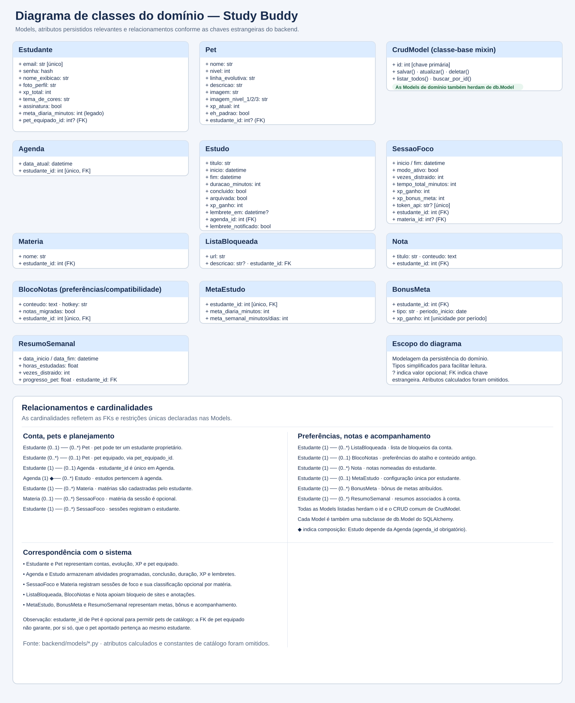

# Diagrama de classes do domínio

O diagrama abaixo foi conferido com todas as Models em `backend/models/`. A imagem SVG é exibida diretamente pelo GitHub e mantém o texto nítido ao ampliar.

[Abrir ou baixar a imagem do diagrama](./diagrama_classes.svg)

O diagrama apresenta as doze Models de domínio, seus principais atributos persistidos, chaves estrangeiras, cardinalidades e a classe-base `CrudModel`. Os atributos calculados e constantes de catálogo foram omitidos para manter a leitura. `BlocoNotas` mantém as preferências do atalho do bloco de notas; seu campo de conteúdo é legado porque as anotações atuais são armazenadas em `Nota` e o texto antigo é migrado para essa Model.

## Correspondência com o sistema

- **Conta e gamificação:** `Estudante` e `Pet` representam os usuários, seus pets e progresso.
- **Planejamento e foco:** `Agenda`, `Estudo`, `SessaoFoco` e `Materia` armazenam tarefas agendadas, sessões de foco e sua associação opcional a matérias.
- **Produtividade pessoal:** `ListaBloqueada`, `BlocoNotas` e `Nota` representam sites bloqueados e anotações.
- **Acompanhamento:** `MetaEstudo`, `BonusMeta` e `ResumoSemanal` guardam as metas, bônus concedidos e resumos.

As Models herdam o identificador e as operações CRUD comuns de `CrudModel`, além de `db.Model` do SQLAlchemy. A figura indica composição entre `Agenda` e `Estudo`, pois cada estudo exige uma agenda. O campo `Pet.estudante_id` é opcional para permitir itens de catálogo sem proprietário; `Estudante.pet_equipado_id` aponta para o pet equipado, mas essa chave estrangeira isoladamente não assegura que o pet pertença à mesma conta. A Model `BonusMeta` está declarada em `backend/models/meta_estudo.py` junto à `MetaEstudo` e é importada pelo pacote `backend.models`.
