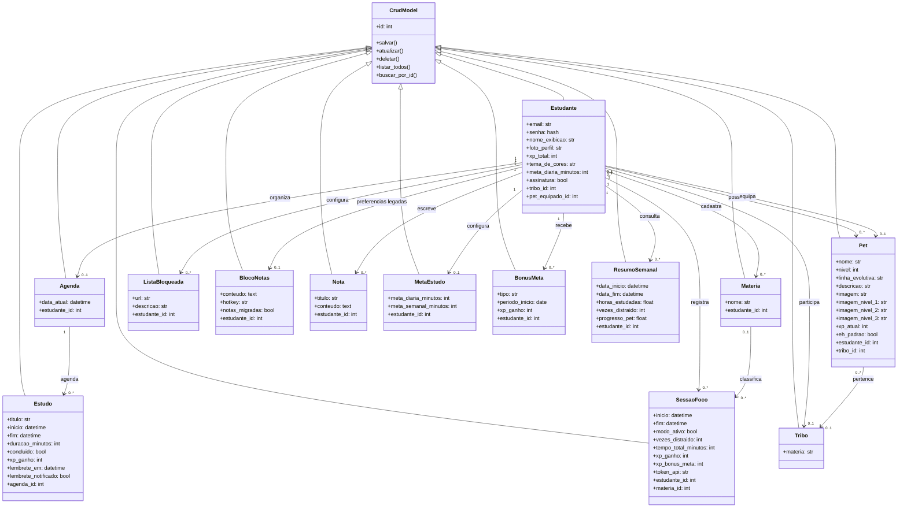

# Diagrama de classes do domínio

O diagrama representa as Models atuais e seus relacionamentos por chave estrangeira. `BlocoNotas` e `Estudante.meta_diaria_minutos` permanecem apenas para compatibilidade e migração de dados antigos.

`Estudante` herda de `CrudModel` e de `db.Model`, assim como as demais Models de domínio. `MetaEstudo` tem uma configuração por estudante; `BonusMeta` impede premiações duplicadas para o mesmo tipo e período. A matéria de uma sessão é opcional.
